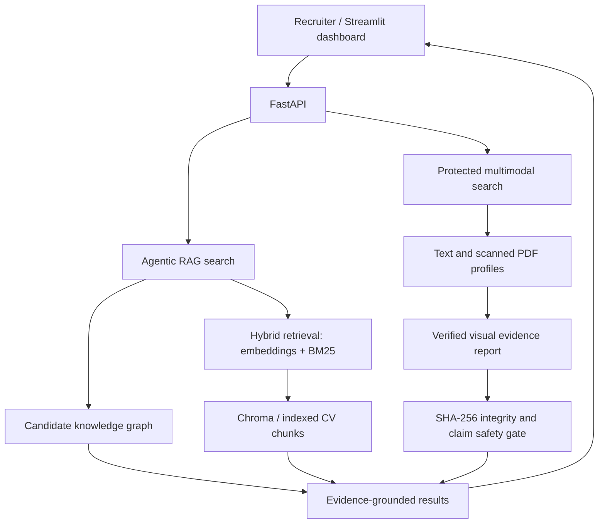

# CV Intelligence

**Evidence-grounded CV search and analysis with Agentic RAG, GraphRAG, and protected multimodal retrieval.**

CV Intelligence is a Python portfolio project that explores how recruiters can search candidate CVs while retaining traceable evidence for each result. It combines document ingestion, semantic and lexical retrieval, agent-based evaluation, candidate knowledge graphs, and scanned-document verification in a FastAPI backend and Streamlit interface.

> **Project status:** Research/portfolio prototype evaluated primarily on synthetic CVs. A skill mention in a CV is **not** proof of proficiency, employment history, or suitability for a role. This system is not intended to make autonomous hiring decisions.

## Highlights

- **Document ingestion:** PDF and DOCX CV processing, chunking, and structured candidate profiles.
- **Retrieval-augmented search:** OpenAI embeddings with Chroma, lexical BM25 retrieval, and retrieval experiments including contextual enrichment and late chunking.
- **Agentic RAG:** LangGraph-based candidate retrieval, evidence checks, and grounded summaries.
- **GraphRAG:** A candidate knowledge graph connecting candidates, skills, experience, projects, and supporting chunks.
- **Multimodal CV processing:** A hybrid text/vision pipeline for text-based and scanned PDFs.
- **Evidence safety:** Candidate/source binding, claim-level verification, source-page provenance, SHA-256 document integrity checks, and abstention when evidence is missing or uncertain.
- **Application:** FastAPI endpoints and a Streamlit dashboard with separate Agentic RAG and Protected Multimodal Search experiences.
- **Evaluation:** Synthetic benchmark experiments, negative claim tests, and repeatable automated regression suites.

## Architecture



The protected search path checks the saved verification record against the current source PDF before accepting evidence. Verification reports are generated in an earlier, explicit processing step; **normal protected-search requests do not call a vision model**.

## Technology stack

| Layer | Technologies |
|---|---|
| Language | Python 3.12 |
| API | FastAPI, Pydantic, Uvicorn |
| UI | Streamlit, Requests |
| Agent workflow | LangGraph |
| Embeddings / model experiments | OpenAI API (`text-embedding-3-small`, `gpt-4.1-mini`) |
| Vector retrieval | Chroma |
| Lexical and graph retrieval | BM25 and project-specific graph processing |
| PDF processing | PyMuPDF and text/vision extraction |
| Testing | Python `unittest`, FastAPI `TestClient` |

See [`pyproject.toml`](pyproject.toml) for the authoritative dependency list and version constraints.

## Repository guide

```text
cv-intelligence/
├── cv_intelligence/
│   ├── api.py                    # Main FastAPI application
│   ├── protected_api.py          # Protected multimodal endpoint
│   ├── dashboard.py              # Streamlit interface
│   └── ...                       # Application modules
├── scripts/
│   ├── agentic_rag/              # Agentic RAG workflows
│   ├── data_preparation/         # Ingestion and data preparation
│   ├── evaluation/               # Benchmarks and evaluation
│   ├── graphrag/                 # Knowledge graphs and GraphRAG
│   ├── multimodal/               # Multimodal evidence and verification
│   ├── retrieval/                # Search and retrieval experiments
│   └── utilities/                # Supporting utilities
├── tests/                        # Automated tests
├── data/                         # Local datasets and generated artifacts
├── pyproject.toml
├── Dockerfile
├── compose.yaml
└── README.md

Some data and generated verification reports are local artifacts and may not be included in a public clone. Check the prerequisites below before running the protected demo.

## Getting started

### Prerequisites

- Python **3.12** (the development environment used for this project)
- Git
- An OpenAI API key **only for workflows that call OpenAI**, such as new embedding generation or live visual verification
- A local copy of the required synthetic CV data and generated artifacts for the corresponding demo

### 1. Clone and install

```bash
git clone <YOUR-REPOSITORY-URL>
cd cv-intelligence
python3.12 -m venv .venv
source .venv/bin/activate
python -m pip install --upgrade pip
python -m pip install -e .
```

On Windows, use the appropriate virtual-environment activation command for your shell. The project was developed on Ubuntu 24.04 under WSL2.

### 2. Configure environment variables

Use the existing example configuration as your starting point:

```bash
cp .env.example .env
```

Edit `.env` and supply only the values required by the workflow you plan to run. Consult `cv_intelligence/config.py` for the configuration schema. **Never commit `.env`, API keys, credentials, or real candidate data.**

For workflows requiring OpenAI, configure the appropriate OpenAI API key using the project's environment configuration.

### 3. Start FastAPI

```bash
python -m uvicorn cv_intelligence.api:app --host 127.0.0.1 --port 8001
```

- API documentation: <http://127.0.0.1:8001/docs>
- Health check: <http://127.0.0.1:8001/health>

The local Streamlit dashboard defaults to port **8001** for the API. Docker configuration may expose the API on port **8000** instead; adjust the dashboard's base URL accordingly.

### 4. Start Streamlit

In a **second terminal**:

```bash
source .venv/bin/activate
python -m streamlit run cv_intelligence/dashboard.py
```

Open the local URL printed by Streamlit (commonly `http://localhost:8501`; the port can differ if already in use).

To override the API base URL:

```bash
CV_INTELLIGENCE_API_URL=http://127.0.0.1:8000 \
  python -m streamlit run cv_intelligence/dashboard.py
```

## Using the application

### Agentic RAG Search

The **Agentic RAG Search** tab searches the indexed CV collection and presents candidate summaries, skill mentions, and supporting text excerpts. This workflow may depend on local indexes, saved profiles, and configured model services.

### Protected Multimodal Search

The **Protected Multimodal Search** tab uses the saved synthetic scanned-CV profile and protected visual-verification report. For the controlled demo, try:

| Query | Required skills | Expected result |
|---|---|---|
| `Python Docker` | `Python, Docker` | Candidate `M001`; 4 accepted evidence items |
| `Recruitment Analytics Dashboard` | Leave empty | Candidate `M001`; 2 accepted evidence items |
| `Kubernetes Terraform` | `Kubernetes, Terraform` | No eligible candidates |

Accepted evidence includes the field, source filename, page number, claim decision, and integrity status. The UI explicitly states that verified **CV mentions** are not independently confirmed qualifications.

**Required local demo artifacts** include the scanned synthetic PDF, its extracted profile, and the protected real-vision verification report, such as:

```text
data/multimodal/input/synthetic_scanned_cv.pdf
data/multimodal/hybrid_profiles/synthetic_scanned_cv_profile.json
data/multimodal/provenance/protected_real_vision_verification.json
```

If these are absent from your checkout, the protected demo must be prepared before it can run. Do not fabricate or hand-edit a verification report to bypass the verification workflow.

## API examples

### Health check

```bash
curl http://127.0.0.1:8001/health
```

### Agentic search

```bash
curl -X POST http://127.0.0.1:8001/search \
  -H 'Content-Type: application/json' \
  -d '{"query":"Python Docker engineer","limit":5}'
```

### Protected multimodal search

```bash
curl -X POST http://127.0.0.1:8001/multimodal/protected-search \
  -H 'Content-Type: application/json' \
  -d '{"query":"Python Docker","required_skills":["Python","Docker"]}'
```

The protected endpoint returns eligible candidates and accepted evidence; it does not expose arbitrary PDF-path selection to the caller. The demo's API response includes an evidence count for withheld items rather than exposing their unsupported text.

## Evaluation results

The following results were observed in the **local, synthetic demonstration**, not on an external recruitment benchmark.

| Evaluation | Observed result |
|---|---|
| Phase 6B profile consistency | 6/6 fields |
| Phase 6B protected-evidence preparation and claim checks | Completed |
| Phase 6C protected visual evidence | 6/6 supported |
| Phase 6C document fingerprint | SHA-256 match |
| Phase 6C protected queries | 3/3 passed |
| Phase 6C integrity scenarios | 2/2 passed |
| Phase 6C grounded-answer regression suite | 27/27 passed |
| Phase 7 FastAPI routes | 3/3 verified |
| Phase 7 protected HTTP query checks | 3/3 passed |
| Phase 7 HTTP and grounded-answer tests | **39/39 passed** |
| Phase 7 evaluation rerun | Passed twice in the development environment |

The Phase 7 evaluation checked **six accepted evidence items across three test queries**. This is an in-sample controlled test, not a measure of generalization.

A separate synthetic GraphRAG experiment reported **nDCG@5 of 0.890** for a BM25-plus-graph configuration. That result belongs to its specific synthetic benchmark and should not be compared directly with the protected multimodal test metrics.

### Reproduce the evaluations

With the necessary local synthetic inputs and saved verification artifacts available:

```bash
python -m scripts.evaluation.evaluate_phase_6c
python -m scripts.evaluation.evaluate_phase_7
```

Run the focused regression suites:

```bash
python -m unittest tests.test_protected_api -v
python -m unittest discover -s tests -p 'test_*grounded_answers.py' -v
```

The Phase 7 evaluation writes:

```text
data/multimodal/final_evaluation/phase_7_results.json
data/multimodal/final_evaluation/phase_7_summary.md
```

The evaluation scripts reuse saved verification artifacts and **do not require new OpenAI API calls**. Creating a new protected visual-verification report is a separate, potentially billable workflow.

## Evidence integrity and safety model

The protected multimodal pipeline uses several safeguards:

1. **Source binding:** Evidence must match the expected candidate, profile field, source document, and page.
2. **Visual verification:** The saved protected report records whether the model supported, rejected, or could not determine each scanned-PDF evidence item.
3. **Document fingerprinting:** SHA-256 checks compare the current PDF bytes with the bytes bound to the protected verification record.
4. **Claim safety:** Only supported CV-mention claims are accepted. Fabricated, unsupported, or uncertain claims are rejected or withheld.
5. **Fail-closed behavior:** Missing or modified source PDFs do not yield accepted evidence in the tested scenarios.
6. **Provenance:** Accepted evidence retains its source filename and page number.

A SHA-256 match establishes byte consistency with the stored fingerprint; it **does not authenticate who produced the verification report**. The prototype does not implement a complete trusted-report signing, authorization, or audit infrastructure.

## Limitations and responsible use

- **Synthetic data:** The protected multimodal evaluation uses one synthetic candidate represented by text and scanned PDFs. Broader accuracy, robustness, and generalization remain untested.
- **Model fallibility:** Vision-based evidence verification can make mistakes; a supported status is not independent factual validation.
- **Document mentions only:** A CV statement cannot establish proficiency, identity, job performance, or credential authenticity.
- **No hiring automation:** Candidate results are research aids, not hiring decisions. Human review is required.
- **Fairness and privacy:** Bias, adverse impact, consent, retention, and access controls have not been comprehensively evaluated.
- **Local artifacts:** The prototype uses local data and reports. Public deployment would require authentication, authorization, secret management, audit logging, and secure storage.
- **Performance:** Latency, throughput, concurrency, and production-scale reliability have not been established.
- **Environment-dependent reproduction:** The protected demo requires the specific synthetic inputs and protected verification artifacts used in evaluation.

**Do not upload real applicants' CVs or deploy this system for operational recruitment without appropriate privacy, security, legal, and fairness review.**

## Suggested portfolio demonstration

1. Show the **Agentic RAG Search** tab and the retrieved candidate's supporting CV excerpts.
2. Switch to **Protected Multimodal Search** and run `Python Docker`.
3. Open candidate `M001` and show the four accepted evidence items, PDF page provenance, and matching integrity status.
4. Run `Kubernetes Terraform` to demonstrate that unsupported skills do not produce an eligible candidate.
5. Run `python -m scripts.evaluation.evaluate_phase_7` and show the **39 passing tests** and saved Markdown evaluation report.
6. Explain the distinction between **verified document mentions** and **independently validated qualifications**.

## Roadmap

- Expand the multimodal benchmark beyond one synthetic candidate and add more document layouts.
- Add independent human annotation and evaluate precision, recall, abstention quality, and calibration.
- Introduce authenticated verification records, role-based access controls, and secure artifact storage.
- Add automated browser tests and production-like deployment checks.
- Perform privacy, fairness, and robustness assessments before considering real-world use.

## License

No license is specified here. Add a `LICENSE` file and update this section if you decide to publish the repository under an open-source license.

---

*CV Intelligence is an educational and research portfolio project focused on evidence traceability, retrieval quality, and safe handling of uncertain CV claims.*
